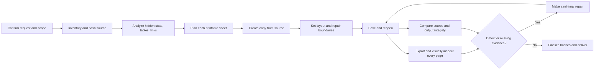

# Excel print layout: layers, tasks, progress, and evidence

This reference describes a reproducible print-layout workflow. A4 and hidden-state preservation are common defaults; obey the user's requested paper, scope and treatment of hidden content. No actual project workbook, project name, personal path or project quantity belongs in this skill. [한국어](architecture.ko.md)

## Dependency flow



A clean text search is not proof that glyphs or borders are intact. Equal cell values do not prove that external links still target the correct files. Each type of evidence has a distinct role.

## Layers, tasks, and completion gates

| Layer | Tasks | Output and completion condition |
|---|---|---|
| L00 Request and authorization | Establish exact files, recursion, exclusions, paper, hidden-item instructions and output destination | Scoped input/output list; no unrelated overwrite |
| L01 Environment | Inspect Excel, printer, file types, existing Excel processes and available resources | A private Excel instance and safe process cleanup strategy |
| L02 Preserve originals | Record input SHA-256, metadata, output path and file extension | Source and output differ; no collision with unrelated files |
| L03 Workbook inventory | Inspect sheet order/visibility, hidden dimensions, protection, print areas, formulas/caches, links, merges and drawings | Every sheet classified as printable, hidden, empty or excluded |
| L04 Hidden-state model | Expand dimension ranges and capture default-hidden rows and exceptions | A comparison baseline; hidden items remain hidden throughout unless explicitly requested otherwise |
| L05 Table model | Identify title, header, body, totals, merged groups, diagrams and nonprinted helper data | Distinguish intended print content from calculation material |
| L06 Page geometry | Measure visible width/height, figures, margins and apparent font size | Orientation and scale candidates with readability rationale |
| L07 Pagination | Decide one page versus multiple pages, repeated labels and safe group boundaries | Each page has coherent identification and complete table boundaries |
| L08 Idempotent plan | Bind exact target properties and repair objects to source hash and request fingerprint | Re-running the same work reuses a verified output or converges to the same state |
| L09 Open in Excel | Private COM instance, disable macros/events/link updates, manual calculation | Source opens read-only; track the PID and never quit somebody else's Excel |
| L10 Copy and links | SaveAs the same workbook format to its intended location | Source stays unchanged and actual external-link targets are checked |
| L11 Paper and dimensions | Set print area, orientation, margins, scale and visible row/column sizes | Intended content fits; hidden states remain intact |
| L12 Breaks and repeat titles | Rebuild only unintended manual breaks, set appropriate repeated rows/columns | Headers and identifiers repeat without splitting merged groups |
| L13 Visual repairs | Fix clipping, missing boundary lines and drawing overlap | Minimal, nonduplicated changes; data/merges/hidden states preserved |
| L14 Save and reopen | Reopen the saved file and inspect paper, scale, breaks and links | The saved settings and targets actually match the intended plan |
| L15 Rendered output | Export each printable sheet to PDF and review every page | Page size, count, readability, borders, titles, clipping and blank pages checked |
| L16 Integrity | Compare original and output hidden state, merges, values, formulas/caches, sheet states and links | No unexplained differences within each tool's stated coverage |
| L17 Repair and regression | Record failures, make the smallest correction, repeat affected checks | No pre-repair PDF is treated as final evidence |
| L18 Finalize and deliver | Record final hashes, gates, temporary evidence, output path and limitations | Only verified deliverables are called complete |

## Detailed mechanisms

### Scope, source, and output

- Enumerate the user's exact folder and extensions. Honor an explicit nonrecursive scope and exclusion list. Do not treat `~$` lock files, output folders or earlier revised files as source inputs.
- Bind the plan and ledger to the original SHA-256. Preserve `.xls`, `.xlsx`, `.xlsm`, and other explicitly supported formats; work on named copies. Never overwrite an unrelated existing output. A source hash change invalidates its previous baseline and plan.
- Put intermediate PDF files, rendered pages, trial copies, scripts and evidence in the user's designated temporary/deletion folder. Do not publish source workbooks, customer paths, screenshots or private calculation data to a public repository.
- Avoid editing a workbook currently being changed or synchronized. Distinguish a newly produced copy from an original that other workbooks still reference.

### Hidden rows, columns, and sheets

- Do not unhide hidden sheets, rows or columns, even temporarily, unless the user explicitly asks for that. Do not reveal hidden rows simply to fill a page.
- OOXML can represent multiple columns in one range, for example `<col min="11" max="15" hidden="1">`. Compare every column from `min` through `max`, not only the first key. Capture the default row-hidden setting and explicit exceptions. For `.xls`, inspect BIFF formatting metadata and verify in Excel when needed.
- Setting `ColumnWidth` on a hidden Excel column can unhide it. Query each target column first and change only visible columns. Apply the same rule to row heights, mixed ranges and `AutoFit`.
- Preserve sheet order and visibility. Normally, printable sheets are visible sheets with intended content; hidden sheets still belong to the integrity comparison. Respect user instructions and the existing intended print area.

### Physical geometry and pagination

Excel uses points for many measurements. A4 is approximately `595.28 × 841.89 pt`; swap the dimensions for landscape. For each orientation estimate:

```text
available width  = paper width  - left and right margins
available height = paper height - top and bottom margins
approximate one-page scale = min(available width / visible content width,
                                 available height / visible content height)
```

This is an estimate, not a replacement for exporting the page. Printer nonprintable margins, repeat rows/columns, headers/footers, merged cells, column-width conversion and drawings affect Excel's actual result. Evaluate the **printed font size** after scaling; an entire table on one page is not useful if the text cannot be read.

- Fit a modest table on one page where that produces readable type. Remove empty formatting-only rows from the print area only after checking that no intended notes or values are excluded.
- For a long table, fit the width if legible, split at row/section boundaries and repeat headers. Do not orphan a heading at the bottom of a page.
- For an exceptionally wide table, consider splitting at complete column-group boundaries and repeating identification columns such as station and distance. Each page must show a complete header and closed border; map all data columns and rows so no information is lost. Do not split merged cells or arbitrary columns merely to increase zoom.
- Compare portrait and landscape: a tall narrow table can use a portrait page more effectively. A very short table may still leave vertical whitespace; do not invent content or reveal hidden rows to remove it.
- `FitToPagesWide=1` with unlimited height is a candidate for long tables. A one-page tall setting is only suitable when readable. Manual breaks, repeat titles and Excel's fit/zoom modes can interact; inspect the saved properties and the rendered pages rather than assuming the requested values persisted.

### Repeatability and idempotence

1. Compute the request fingerprint, source SHA-256, plan hash and final output hash. Reuse the verified output without opening and resaving it when all hashes and the request agree.
2. Use [print-plan.example.json](../assets/print-plan.example.json) as a shape, not as default layout values. Record target paper, orientation, print area, absolute scale, margins, repeated titles, break addresses, visible row/column targets and any identified repair objects.
3. Do not repeatedly apply operations such as `width × 1.2`, `height + 2` or `add a line`. Start from the source and set absolute target values. If the current state already matches, do nothing.
4. Inspect manual breaks before rebuilding only the intended set. Preserve useful repeat titles. Test the interaction between breaks and fit/zoom after reopening.
5. Name assistant-created print-only objects deterministically and record their purpose, sheet, anchor and provenance. Check for an existing object before adding one. Never delete or repurpose a user-created object with a colliding name. If ownership is uncertain, stop and report.
6. If the request, source, plan, output or evidence changes, invalidate the affected checks and stage a new copy from the original. Do not silently overwrite an unrelated deliverable.

`progress_ledger.py` detects changed source/output/plan hashes and gates. It does not modify workbooks or prove the truth of a human visual review. Use a single coordinator to write each ledger; parallel workers should produce separate evidence and report to the coordinator.

### Native Excel and links

- Prefer a separate Windows Excel instance via `DispatchEx`. Disable events, macros and update prompts; open the original read-only with `UpdateLinks=0`. Set manual calculation and `CalculateBeforeSave=False`; some Excel installations require a temporary blank workbook before setting calculation mode. Do not recalculate or refresh connections unless requested.
- A plain filesystem copy into another folder can change how a relative external link resolves. Open the source in Excel and `SaveAs` the same file type at the intended destination, then reopen the copy and compare the actual `LinkSources` targets. Different path text may resolve to the same target; equal-looking strings are not alone proof of correct resolution.
- If Excel reports no links but formulas suggest an external reference, inspect BIFF/OOXML or Excel more closely. Preserve and report pre-existing inaccessible or broken links instead of fixing unrelated source data. Revised workbooks do not necessarily link to each other; report when they still reference the original folder.
- `PrintCommunication=False` can improve performance but has been observed to lose requested zoom changes. Turn communication back on, re-read zoom and page settings, save, reopen and compare the actual PDF.
- Limit parallel Excel instances according to memory and system load. Record each instance PID, close only the instance you created and never bulk-kill unidentified Excel processes. Avoid naming a Python task script `inspect.py`, which can shadow the standard library and launch unintended work.

### Borders, text, and drawings

- A merged cell extending into hidden rows can lose its apparent bottom border even when a border is set on the last visible row. Preserve the hidden state and merge. Test the top border of the next **already visible empty** row only if it does not expose previously unprinted values. Never blindly extend the print area.
- If a line object is necessary, anchor a short line to the visible boundary, identify it as assistant-owned, and inspect other pages for overlap. Shapes crossing hidden rows may disappear or move after saving; verify both the trial and the reopened output.
- `###` usually calls for checking the visible numeric column width. Cut top/bottom glyphs call for inspecting visible row height, wrapping or vertical alignment. Confirm the complete string in the actual PDF, not just the cell value. Do not adjust hidden dimensions.
- If a figure overlaps a heading or line, first test minimal position/size changes while preserving the actual diagram. Text baked into an image or EMF does not grow when a cell font changes. If further scaling would overlap another figure or exceed the page, report the remaining size limit.
- Inspect all four edges and the first/last rows of each printed page. In multipage tables inspect repeat headers and identifiers. Text extraction and pixel metrics only identify candidates; visually inspect the page at usable resolution.

### Progress, evidence, and resumption

Keep workbook gates `inventory → baseline → reopen → content → links` and, for each printable sheet, `plan → pdf → visual`. Record `passed`, `failed` or `not_applicable` with concrete evidence. Every `passed` gate needs a hashed evidence file; each sheet's `plan` evidence includes the final plan itself. `not_applicable` for links requires evidence that no external links exist. Hidden, empty and excluded sheets are explicitly inventoried but do not need printable-sheet gates.

1. Run `progress_ledger.py init` with source/output paths and a SHA-256 request fingerprint.
2. Add every sheet and its scope; record inventory and baseline evidence.
3. Record each printable sheet's plan, PDF and visual evidence. Record `reopen`, `content` and `links` against the final saved output.
4. `finalize --plan ...` verifies the required gates, exact printable-sheet names in the plan, source hash and current output hash. Output-dependent evidence is tied to the output hash at the time it is recorded.
5. `status` requires the current request fingerprint and reports `stale` if a finalized source, output, plan or evidence file changes. A `verified` ledger is reusable only if its evidence is real. See [the ledger command example](ledger-usage.md).

Do not mark missing PDFs, unreadable text, unexamined links or failed workbook opens as passed. Stop safely and preserve both the original and the last known-good copy if recovery is uncertain.

### Delivery and limitations

- State delivered files, destination, exclusions, important one-page/multipage decisions, hidden-state preservation and the actual checks performed.
- Report external links that still point to the original directory. Do not promise that moving a workbook to another machine or drive retains link resolution.
- Report actual readability limitations, incomplete checks and printer-dependent margins. Mention unrelated source data discrepancies with cell locations, but do not alter the engineering figures as part of print formatting.
- A PDF export and reopened Excel file are not the same as a physical printer test. Report the evidence that was actually obtained.
