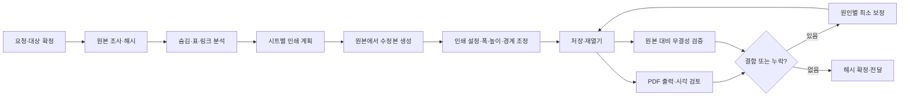

# 엑셀 인쇄 레이아웃: 계층, 작업, 진척 및 검증

이 문서는 A4 인쇄 정리를 재현하기 위한 상세 작업 명세다. A4와 숨김 보존은 기본 적용 사례이며, 사용자가 용지·출력 대상·숨김 처리에 관해 다르게 지시하면 그 지시를 따른다. 실제 엑셀 원본, 사업명, 개인 경로, 수량은 이 스킬에 포함하지 않는다. [English](architecture.en.md)

## 처리 흐름



서로 다른 검증을 합쳐서 성공이라고 단정하지 않는다. 예를 들어 `###` 자동 검색이 0건이어도 그림 안의 잘린 문자는 남을 수 있고, 수식이 동일해도 외부 연결의 실제 대상이 잘못될 수 있다.

## 작업 계층과 완료 관문

| 계층 | 작업 | 결과 및 통과 기준 |
|---|---|---|
| L00 요청·권한 | 대상 경로, 최상위/재귀, 제외 파일, 원본과 복사본, 용지, 숨김 및 분할 선호를 확정 | 대상·제외 목록과 결과 위치 기록. 지정되지 않은 원본 덮어쓰기 금지 |
| L01 실행 환경 | Excel 설치·프린터·파일 형식·현재 Excel 프로세스·메모리 확인 | 개인 Excel 창을 건드리지 않는 전용 인스턴스 및 정리 계획 |
| L02 원본 보존 | 원본 해시·시각·크기, 복사본 경로와 같은 확장자 기록 | 원본과 수정 경로가 다름. 기존 결과물과 충돌하지 않음 |
| L03 통합문서 조사 | 시트 순서/표시/숨김, 차트 시트, 보호, 인쇄영역, 수식·캐시·외부 링크, 병합·도형 조사 | 각 시트가 출력 대상/숨김/빈 시트/명시적 제외 중 하나로 분류 |
| L04 숨김 모델 | 숨긴 행·열의 실제 범위, 기본 행 숨김 및 개별 예외 확인 | 최종 범위와 원본 범위를 비교할 기준. 작업 중 숨김을 풀지 않음 |
| L05 표 모델 | 제목·머리글·본문·합계·병합 그룹·도면·보조 계산영역 구분 | 출력해야 할 내용과 의도적으로 제외한 내용을 분리 |
| L06 물리 치수 | 숨김을 제외한 폭·높이, 병합/도형의 인쇄 점유, 글자 크기와 종이 여백 계산 | 방향·축소·확대 후보와 가독성 판단 근거 |
| L07 페이지 구성 | 가로/세로, 1쪽 여부, 반복 제목, 논리적인 행·열 구분 결정 | 각 페이지에서 표 식별자와 머리글이 이해 가능하고 병합·테두리 보존 |
| L08 멱등 계획 | 원본 해시·요청 지문과 시트별 절대 목표치, 구분선 및 보완 객체 명세 | 동일 입력/계획의 재실행은 검증된 결과를 재사용하거나 같은 목표 상태로 수렴 |
| L09 Excel 열기 | 별도 Excel 프로세스, 매크로/이벤트/연결 갱신 차단, 수동 계산 | 원본은 읽기 전용. 프로세스 PID 확인, 다른 Excel은 종료하지 않음 |
| L10 복사와 연결 | Excel `SaveAs`로 동일 형식의 새 위치에 저장 | 원본 SHA 유지, 새 파일에서 기존 외부 연결의 실제 대상 확인 |
| L11 용지와 크기 | 인쇄영역·A4·방향·여백·배율·보이는 행/열 치수 설정 | 의도한 인쇄 범위만 포함, 숨김 변경 없음 |
| L12 나눔과 반복 | 불필요한 수동 나눔만 재구성, 반복 행/열 설정 | 표 전체 또는 의미 있는 묶음이 페이지별로 보이고 머리글과 식별열이 유지됨 |
| L13 시각 보정 | 잘린 문자·숫자, 병합셀 하단선, 제목·그림 겹침 수정 | 데이터/병합/숨김을 유지한 최소 보정. 선이나 도형 중복 없음 |
| L14 저장·재열기 | 저장본을 닫고 다시 열어 용지·배율·구분·링크를 확인 | 설정이 저장 후에도 유지됨. 재계산이나 링크 갱신을 임의로 실행하지 않음 |
| L15 실제 출력 | 인쇄 대상 시트별 PDF 생성, 모든 페이지 검사 | 용지·쪽수·가독성·여백·외곽선·반복 제목·잘림·빈 페이지 확인 |
| L16 무결성 검증 | 원본/수정본의 숨김 범위·병합·셀 값·수식·캐시·링크·시트 상태 대조 | 해당 검사의 범위가 명확하고 불일치가 없거나 차이가 설명됨 |
| L17 수리와 회귀 | 실패한 페이지와 원인을 기록하고 작게 고친 뒤 영향받는 출력·검사 재실행 | 수정 이전 PDF를 그대로 합격 증거로 쓰지 않음. 해결 불가시 구체적으로 보고 |
| L18 확정·전달 | 최종 해시, 파일별 관문, 임시 자료, 결과 위치, 연결·가독성 한계 정리 | 모든 필수 관문 통과한 결과만 완성으로 표시 |

## 단계별 세부 메커니즘

### 1. 대상과 원본

- 원본 디렉터리를 먼저 열거하고 확장자 및 사용자의 제외 목록을 적용한다. `~$` 잠금 파일, 출력 폴더, 이전 수정본을 원본으로 재처리하지 않는다. 요청이 최상위 폴더에 한정되면 재귀하지 않는다.
- 원본 파일의 SHA-256을 계획과 진척 기록에 연결한다. 복사본은 원본과 같은 `.xls`, `.xlsx`, `.xlsm` 등 형식을 유지한다. 수정본 경로는 사용자가 알아볼 수 있게 하고, 동명의 타인 결과는 덮어쓰지 않는다.
- 중간 PDF·이미지·스크립트·실패한 시안·검증 JSON은 사용자가 정한 임시/삭제 폴더에 보관한다. 공용 저장소에는 사업 파일이나 출력물, 실제 경로와 수치를 넣지 않는다.
- 원본이 이미 열려 있거나 동기화 중이면 충돌을 피한다. 실제 변경 시점에 원본 해시가 바뀌면 이전 계획을 무효화하고 다시 조사한다.

### 2. 숨김과 시트 구조

- 숨김 시트와 숨김 행/열은 사용자 허용 없이 한 번도 해제하지 않는다. 보이는 표가 짧더라도 숨긴 내용을 표시하여 용지를 채우지 않는다.
- OOXML은 `<col min="11" max="15" hidden="1">`처럼 여러 열을 한 범위로 기록할 수 있다. 첫 열만 비교하지 말고 `min`부터 `max`까지 펼쳐 비교한다. 기본 숨김 행과 명시적 예외도 별도로 본다. `.xls`는 BIFF 서식 정보와 Excel 상태로 대조한다.
- Excel에서 **숨김 열의 `ColumnWidth` 설정 자체가 숨김을 풀 수 있다**. 숨김 여부를 개별 열에서 먼저 읽고 보이는 열만 변경한다. 행 높이와 `AutoFit`도 같은 원칙을 적용한다. 여러 열을 한꺼번에 변경할 때 보이는 열과 숨김 열이 섞여 있으면 안 된다.
- 모든 시트는 목록과 표시 상태를 보존한다. 인쇄 대상은 보통 내용이 있는 표시 시트이지만, 기존 인쇄 의도와 사용자의 지시를 우선한다. 숨김 시트는 내용 비교 대상이며 임의로 출력하거나 수정하지 않는다.

### 3. 물리 페이지와 인쇄 계획

Excel은 치수를 대체로 포인트(pt) 단위로 다룬다. A4는 약 `595.28 × 841.89 pt`다. 가로 방향에서는 두 수치를 바꾼다. 후보 방향별로 다음을 추정한다.

```text
사용 가능 폭 = 용지 폭 − 좌우 여백
사용 가능 높이 = 용지 높이 − 상하 여백
대략적 1쪽 배율 = min(사용 가능 폭 / 보이는 내용 폭,
                     사용 가능 높이 / 보이는 내용 높이)
```

이는 후보 선택을 위한 근사치다. 프린터의 비인쇄 영역, 반복 행/열, 머리글·바닥글, Excel의 열 너비 변환, 병합 셀과 그림이 실제 쪽수에 영향을 준다. **최종 배율은 PDF를 내보내고 다시 읽어 확인한다.** 글자 크기는 원래 크기에 실제 배율이 적용된 결과로 판단한다. 양쪽 비율을 하나의 숫자로 강제하여 읽기 어려운 한 장을 만들지 않는다.

- 표가 작으면 보이는 범위와 배율을 조정해 한 장을 채운다. 빈 서식만 있는 행은 인쇄 의도를 확인한 뒤 인쇄영역에서 제외할 수 있다. 보조계산 열과 비고를 무조건 포함하거나 삭제하지 않는다.
- 표가 길면 보통 폭을 한 장으로 맞추고 행 그룹 경계에서 여러 쪽으로 나눈다. 장마다 머리글을 반복하고 제목만 페이지 끝에 남지 않게 한다.
- 표가 매우 넓어 한 장에서 숫자가 읽히지 않으면, 필요한 경우 병합 그룹 경계에서 열을 나누고 측점·거리 등 식별 열을 반복할 수 있다. 각 부분이 완결된 머리글과 테두리를 갖고 전체 데이터가 빠짐없이 한 번씩 대응되는지 확인한다. 임의의 열 중간이나 병합 셀 중간을 자르지 않는다.
- 세로로 길쭉한 표는 가로 A4보다 세로 A4가 폭을 더 채울 수 있다. 짧은 표나 숨김이 많은 표는 내용 자체가 몇 행뿐이라 세로 여백이 남을 수 있으므로, 무의미한 셀 확대보다 실제 글자와 폭의 가독성을 우선한다.
- `FitToPagesWide=1`, `FitToPagesTall=False`는 긴 표의 폭만 맞추는 후보이며, `FitToPagesTall=1`은 작은 표에만 적합하다. 수동 구분이 필요한 경우 Excel의 `Zoom`/맞춤 설정과 인쇄 제목이 실제 나눔에 어떻게 작용하는지 다시 출력해 확인한다. 저장 전 입력값이 아니라 재열기 값과 출력물이 기준이다.

### 4. 배율·나눔 재현과 멱등성

1. 먼저 동일한 요청의 지문, 원본 해시, 기존 수정본 해시, 계획 해시, 검증 기록이 모두 같은지 확인한다. 이미 `verified`라면 파일을 다시 열어 저장하거나 작업을 중복하지 않는다.
2. 새 계획은 [print-plan.example.json](../assets/print-plan.example.json)의 구조를 사용하되 예제 값은 그대로 적용하지 않는다. 시트별 용지·방향·인쇄범위·배율 모드·여백·반복 제목·구분 위치·행/열 **최종 목표값**을 기록한다. 임시 PDF를 보고 확정한 계획도 저장한다.
3. `너비 × 1.2`, `행 높이 + 2`, `선 추가`를 재실행하는 방식은 누적되므로 피한다. 원본에서 출발해 `해당 열 너비 = 12.0`, `해당 행 높이 = 18pt`처럼 목표값을 설정하고, 현재 값이 같으면 변경하지 않는다.
4. 구분선은 현재 수동 나눔을 조사하고 계획에 필요한 것만 재구성한다. 반복 제목을 무조건 지우지 않는다. 수동 나눔/인쇄영역과 Excel `Fit` 설정의 상호작용을 저장·재열기 후 PDF로 검증한다.
5. 인쇄용 선이나 도형을 새로 만들면 안정적인 이름, 소유 정보, 시트/대상 셀/계획 식별자를 기록한다. 같은 보완이 이미 존재하면 중복 생성하지 않는다. 사용자가 만든 동명 도형이나 원래 도형은 지우거나 변경하지 않는다. 식별이 불확실하면 보류하고 보고한다.
6. 결과 또는 계획이 바뀌면 이전 검증은 무효다. 원본에서 새 스테이징 복사본을 만들고 다시 확인한다. 이미 존재하는 결과를 변경하는 것은 해당 파일의 권한과 사용자의 지시에 따라 결정한다.

`progress_ledger.py`는 원본·결과·계획의 해시와 관문 상태를 기록하여 변경을 탐지한다. 파일을 실제로 변경하는 도구는 아니며, 같은 해시가 품질이나 시각 검토의 진실성을 보장하지는 않는다. 동일 결과를 재사용하려면 현재 요청 지문도 비교해야 한다. 진척 기록은 단일 조정자가 쓰고, 병렬 작업자는 각자 증거를 남겨 합친다.

### 5. Excel COM과 외부 링크

- 가능하면 `DispatchEx('Excel.Application')` 등으로 별도 인스턴스를 만든다. `AutomationSecurity=3`, `EnableEvents=False`, `DisplayAlerts=False`, `AskToUpdateLinks=False`, `UpdateLinks=0`, 읽기 전용 열기, 수동 계산 및 `CalculateBeforeSave=False`를 적용한다. 빈 통합문서를 먼저 만든 후 수동 계산 설정이 가능한 환경도 있다. 원본 내용·계산값을 바꾸거나 외부 데이터를 임의 갱신하지 않는다.
- 하위 폴더에 단순 파일 복사를 하면 상대 링크가 다른 대상을 가리킬 수 있다. 원본을 Excel에서 읽기 전용으로 연 뒤 **실제 최종 경로로** 같은 형식 `SaveAs`하고, 저장본을 재열어 `LinkSources`의 실제 대상이 의도한 원본을 가리키는지 비교한다. 경로 문자열이 달라진 것과 실제 대상이 달라진 것은 구분한다.
- 연결이 없는 것처럼 보이지만 수식에 다른 통합문서 참조가 있다면 BIFF/OOXML이나 Excel에서 추가 확인한다. 접근할 수 없는 원격 경로와 깨진 기존 링크는 원래 상태로 보존하고 검증 한계를 보고한다. 복사본끼리 수식이 재연결된다고 가정하지 않는다.
- Excel `PrintCommunication=False`는 속도를 높일 수 있으나 일부 배율이 저장 시 다른 값으로 바뀌는 사례가 있다. 통신을 다시 켠 뒤 배율을 설정·재조회하고, 저장·재열기와 실제 PDF를 비교한다.
- 여러 인스턴스의 동시 기동으로 메모리가 부족해 RPC/저장 오류가 생길 수 있다. 작은 배치로 시작하고 자원 상태에 따라 조정한다. 각 작업자가 전용 PID를 기록하고 정상 종료한다. PID가 불명확하거나 사용자 파일을 가진 Excel을 일괄 종료하지 않는다. Python 작업 파일을 `inspect.py`로 만들지 않는다.

### 6. 테두리·잘림·도형 보정

- 병합셀이 숨김 행까지 이어지면 보이는 마지막 행 아래에 원래 셀 테두리를 지정해도 출력되지 않을 수 있다. 숨김을 풀거나 병합을 해제하지 말고, 다음 **기존 표시 빈 행**의 윗테두리가 적절한지 확인한다. 다음 행에 출력 범위 밖의 값이 있으면 인쇄영역을 무작정 늘리지 않는다.
- 선 보완이 필요하면 보이는 행의 경계에만 짧은 인쇄용 선을 두고, 글자 및 다른 표와 겹치지 않도록 확인한다. 숨김 행에 걸친 도형은 저장·재열기 후 사라지거나 위치가 바뀔 수 있다. 보완 전후 페이지, 저장 후 다시 출력한 페이지를 모두 확인한다.
- `###`는 숫자 열 폭을, 글자의 윗부분/아랫부분 잘림은 보이는 행 높이·줄바꿈·세로 정렬을 확인한다. 숨김 열은 건드리지 않는다. 해당 셀 또는 실제 PDF의 전체 문자열이 보이는지 확인한다.
- 그림이나 도면과 표 머리글이 겹치면 내용의 삭제나 재작도보다 기존 위치·크기를 최소 조정한다. 도형 안에 포함된 치수는 셀 글꼴 조정으로 커지지 않을 수 있다. 확대가 다른 그림과 충돌하거나 종이를 넘으면 한계를 명시한다.
- 표의 왼쪽·오른쪽·위·아래 테두리와 각 페이지의 마지막 행을 실제 이미지에서 본다. 여러 페이지에서는 매 쪽 첫/끝 행과 반복 제목을 확인한다. 숫자·문자 추출 비교는 누락 후보를 찾는 도구이며 렌더 이미지 판정을 대체하지 않는다.

### 7. 진척 관문과 재개

파일 하나당 `inventory → baseline → reopen → content → links` 관문과, 각 출력 시트의 `plan → pdf → visual` 관문을 기록한다. 각 관문은 `passed`, `failed`, `not_applicable` 중 하나와 구체적인 증거를 갖는다. `passed`는 존재하는 증거 파일의 해시가 필요하며 각 시트 `plan` 증거에는 최종 계획 파일을 포함한다. `links`의 `not_applicable`도 실제 외부 연결이 없다는 확인이 필요하다. 숨김·빈·제외 시트는 범위를 기록하되 출력 관문을 억지로 통과 처리하지 않는다.

1. `progress_ledger.py init`으로 원본/수정 경로, 원본 해시와 요청 지문을 기록한다.
2. 조사한 모든 시트를 `add-sheet`로 분류하고 `inventory`·`baseline` 증거를 기록한다.
3. 출력 대상 시트별 최종 계획과 PDF/시각 검토를 기록한다. 최종 저장본에 대한 `reopen`, `content`, `links`도 기록한다.
4. `finalize --plan ...`은 필수 관문, 계획의 시트 목록, 원본과 현재 결과 해시를 확인하고 최종 해시를 남긴다. 출력 관련 증거는 현재 결과 해시에 결부된다.
5. `status`는 현재 요청 지문을 필수로 받아 비교하며, 검증 후 원본·결과·계획·증거 파일이 바뀌면 `stale`로 표시한다. `verified`여도 증거 내용이 진짜인지 사람이 확인해야 한다. 실제 명령은 [진척 장부 예시](ledger-usage.md)를 참고한다.

PDF가 없는 시트, 비교하지 못한 링크, 열리지 않는 파일, 읽기 어려운 최소 글자 등은 통과로 기록하지 않는다. 작업 실패 시 안전하게 중단하고 원본과 마지막 정상 복사본을 보존한다.

### 8. 전달 시 표현

- 변경된 파일 목록, 결과 폴더, 제외 대상, 주요 1쪽/다쪽 선택, 숨김 유지, 실제 검증 방법을 명시한다.
- 수정본의 외부 수식이 원본 폴더를 계속 참조한다면 그 사실을 알린다. 다른 컴퓨터나 드라이브에서 연결이 자동으로 유지된다고 보장하지 않는다.
- 도면의 작은 치수, 불완전한 자동 검사, 사용자 프린터의 비인쇄 여백 같은 실제 한계를 구체적으로 기재한다. 원본의 수량/규격 불일치는 인쇄 문제와 구별해 위치를 알리고 임의로 수정하지 않는다.
- PDF 확인은 종이 실인쇄 확인과 다르다. PDF와 Excel 재열기를 수행했으면 그렇게 보고하고, 실인쇄하지 않았다면 했다고 말하지 않는다.
